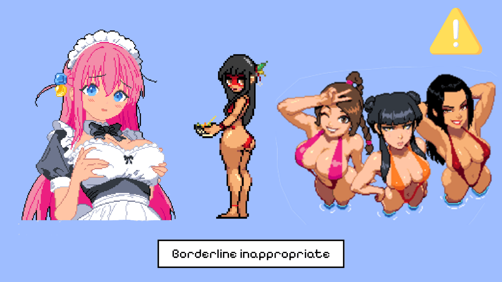
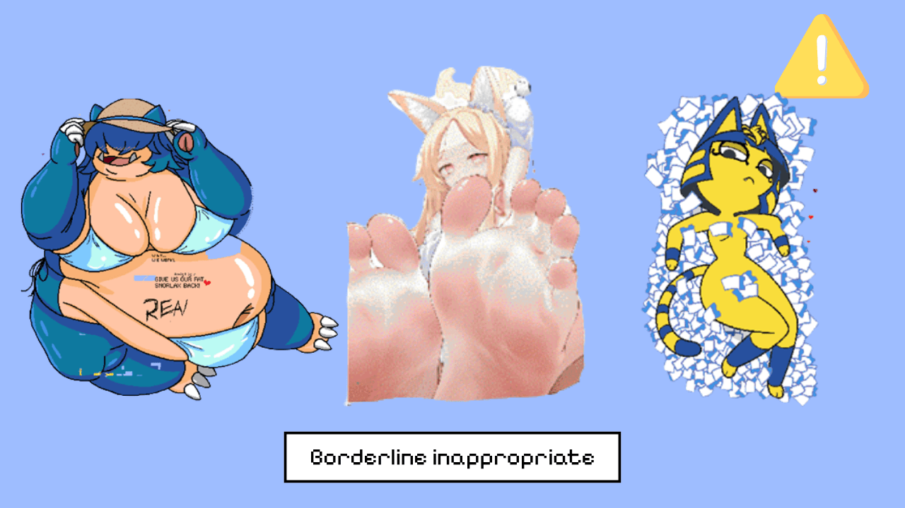
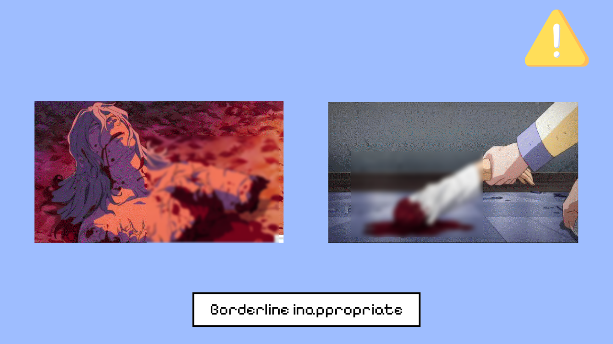
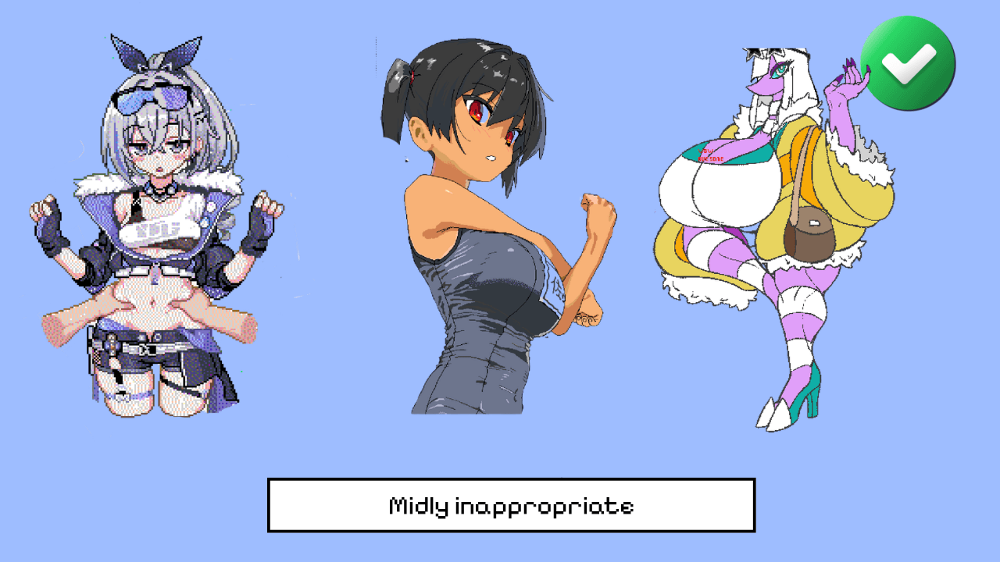
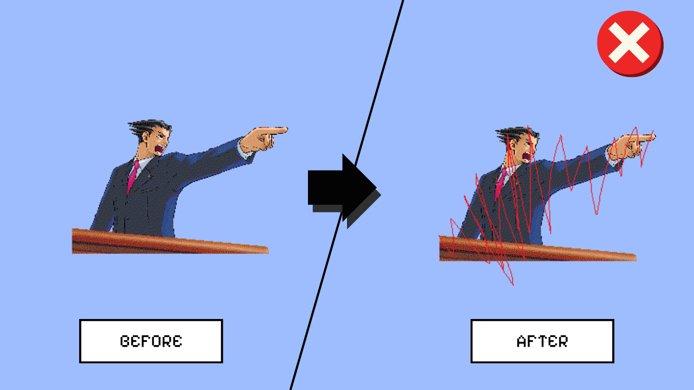
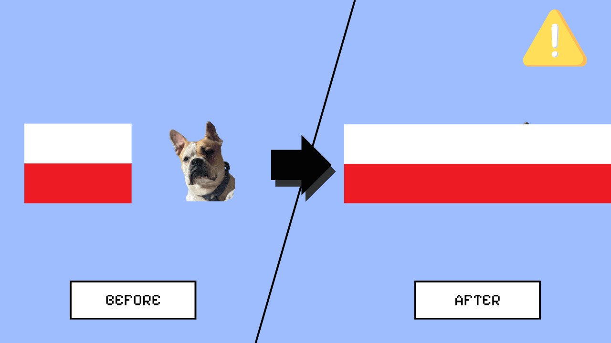
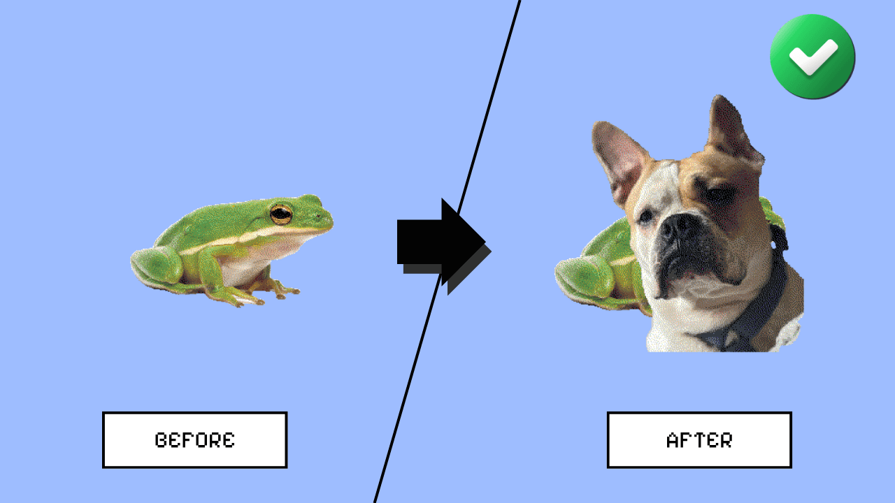
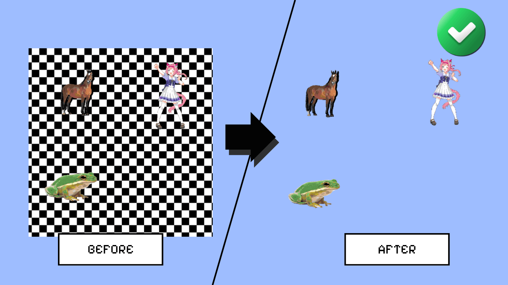

*Bu belgedeki örnekler [Wplace'in resmî topluluk kurallarından](https://wplace.live/terms/community-guidelines) alınmıştır. Kurallar ve görsel örnekleri zamanla değişebilir.*

## ⛔ Kalıcı Yasağa Yol Açabilecek İçerikler

*Resmî kurallara göre aşağıdaki içerikler kalıcı yasağa yol açabilir. Bu bölümde ayrıca görsel örnek bulunmuyor; kategoriler resmî kural metninden özetlenmiştir.*

- Açık cinsel içerik.
- Çocukların cinselleştirilmesi.
- Aşırı gerçekçi şiddet veya grafik şiddet içerikleri.
- Açık nefret söylemi veya nefret sembolleri.
- Başkalarının özel kişisel bilgilerini paylaşmak.
- Aşırı düşmanlık veya belirli kişileri hedef alan taciz.

[Resmî Kaynak: Wplace Topluluk Kuralları](https://wplace.live/terms/community-guidelines)

## ⚠️ Çağrışımlı İçerik Örnekleri

*Resmî kurallara göre bu kategorideki çizimler tek başına uzaklaştırmaya yol açmamalıdır. Topluluk üyeleri bu çizimleri temizleyebilir veya üzerlerini çizebilir.*

## ⛔ Geçici Uzaklaştırma Riski Taşıyan Davranış

*Başka bir oyuncunun çizimini yaratıcı bir amaç olmadan bozmak, kasıtlı çizim bozma (griefing) olarak değerlendirilebilir.*

## ⚠️ Bağlama Göre Değerlendirilebilecek Davranış

*Bir çizimin üzerine bayrak veya tekrarlayan desen çizmek her durumda otomatik olarak ihlal sayılmaz. Davranışın amacı ve devamlılığı önemlidir.*

## ✅ İzin Verilen Davranış Örnekleri

*Bölge mücadelesi kapsamında başka bir çizimin üzerine çizim yapmak, tek başına kural ihlali sayılmaz.*

*Şeffaf piksellerle tekrarlayan desenleri veya uygun olmayan içerikleri temizlemek izin verilen bir davranıştır.*

